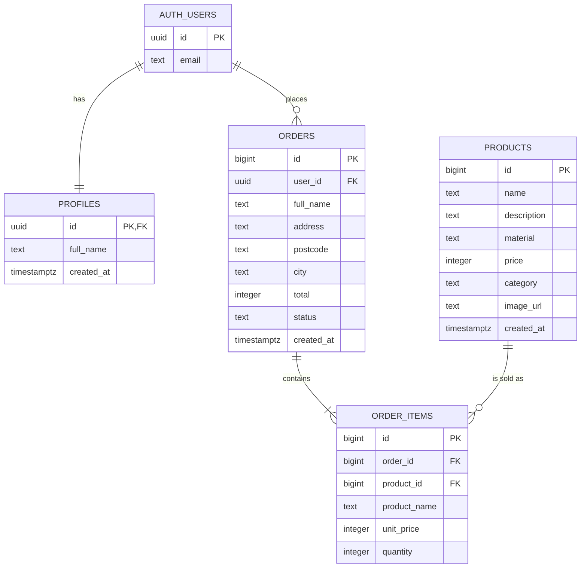

# ER: Cozy Co

`auth.users` is managed by Supabase Auth. We only read its `id` and `email`.

## Rules the diagram does not show

- `products.price`, `orders.total` and `order_items.unit_price` are whole kronor (SEK). `price` and `unit_price` must be greater than 0
- `products.category` must be one of: `lighting`, `furniture`, `textiles`, `decor`, `tableware` (check constraint)
- `order_items.quantity` must be greater than 0 (check constraint)
- `orders.status` defaults to `placed`
- `profiles.id` is the same value as `auth.users.id`, so each user has at most one profile
- On delete: deleting a user deletes their profile and their orders, deleting an order deletes its items, and a product that has been ordered cannot be deleted (`order_items.product_id` restricts)
- `order_items.product_name` and `unit_price` are copied from the product when the order is placed, so an old order keeps its name and price if the product changes later
- Row level security is on for every table, with no policies